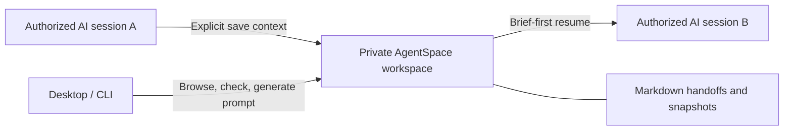

# AgentSpace


**A local-first AI workspace for portable project context, reusable prompts and project handoffs.**

[](LICENSE)
[](https://www.python.org/)
[](https://github.com/guwoh/agentspace/actions/workflows/verify.yml)

[Tiếng Việt](README.vi.md) · [Desktop guide](docs/DESKTOP.md) · [DevSpace setup](docs/DEVSPACE.md) · [Changelog](CHANGELOG.md)

> **Developer Preview v0.2.0:** the first versioned release. Core tests and basic Ubuntu desktop interactions passed; native builds, multi-monitor DPI and real cross-client handoff still require acceptance testing.

## Why AgentSpace?

An AI conversation can end, change models, or move to another authorized account. Your project should not lose its decisions, evidence, tasks and next steps.

AgentSpace keeps that working context in a private Markdown workspace under your control. The desktop app generates prompts and helps navigate the records; an authorized AI with file tools reads and updates them. You decide when to save.

## Quick start

Requirements: Git and Python 3.8+; Tkinter for the desktop interface. On Ubuntu, install your distribution's Tkinter package if it is missing.

```bash
git clone https://github.com/guwoh/agentspace.git
cd agentspace
python3 scripts/agentspace.py init ~/work/agentspace-private
python3 -B scripts/desktop.py --workspace ~/work/agentspace-private
```

On Windows, use `python` instead of `python3` and choose a separate private folder such as `../agentspace-private`. The initializer only creates missing starter files.

In the desktop app, select a project (or generate a new-project prompt), select **Resume**, and use **Generate & copy**. Paste the prompt into your AI after connecting an authorized file-access tool. [DevSpace](docs/DEVSPACE.md) is one option. When you want a handoff, use the **Save context** prompt or explicitly ask the AI to save context.

No AI API key is needed by AgentSpace itself. Clipboard prompts are not sent automatically.

## Features

| Module | What it does |
| --- | --- |
| Projects | Browse the private registry and select a project |
| Prompt Studio | Generate resume, save, overview, handover, skill-update and new-project prompts |
| Context & History | Read brief, full handoff and saved snapshots |
| Skills | Create and edit private Markdown skill definitions |
| Connections | Open AI clients and check for a local DevSpace executable |
| Backup & Settings | Back up and restore private text records; adjust text size |
| CLI | Initialize, list, check and generate startup prompts without the GUI |

## How it works



1. **Work** — select one project; read its brief and the relevant evidence.
2. **Save** — explicitly request a full handoff, snapshot and brief.
3. **Resume** — reconnect file access in another session, select the same project and continue.

The desktop app is a local helper, not an autonomous AI agent. It does not authenticate MCP connections, export chat history or restore unsaved messages. Keep concurrent writers away from the same handoff.

## Private workspace layout

```text
agentspace-private/
├── AGENTS.md
├── protocol/
├── prompts/
├── skills/                     # Optional private skills
└── contexts/
    ├── INDEX.md
    └── demo-site/              # Fictional example project
        ├── BRIEF.md
        ├── CURRENT.md
        └── sessions/
            └── YYYY-MM-DD-NN.md
```

The brief is the first entry point; CURRENT keeps the full handoff, and sessions retain immutable historical copies. The registry records the latest session. Each saved project should keep verified results distinct from plans. See the [workflow](protocol/WORKFLOW.md), [full handoff template](protocol/HANDOFF_TEMPLATE.md), [brief template](protocol/BRIEF_TEMPLATE.md) and [fictional example](examples/BRIEF.md).

### CLI usage

```bash
python3 scripts/agentspace.py status ~/work/agentspace-private
python3 scripts/agentspace.py start ~/work/agentspace-private demo-site
python3 scripts/agentspace.py check ~/work/agentspace-private demo-site
```

Replace the fictional ID with your own registered project. The checker compares the registry, session ID, full snapshot and brief metadata; it does not verify factual accuracy. Existing private folders can keep their registry and history; merge updated templates rather than overwriting files.

## Privacy and trust

- Keep real contexts, credentials, local paths, recordings and attachments outside the public checkout.
- AI file access still requires authorization. A cloud AI may receive the context you give it.
- Backup ZIPs contain private text and are not encrypted. Keep them private.
- Public content is audited with an explicit allowlist and secret/path checks; this is not a guarantee that all sensitive information is detected.

Read the [privacy guide](docs/PRIVACY.md) before publishing a fork or package.

## Development

```bash
python3 -B scripts/test_agentspace.py -v
python3 -B scripts/test_desktop.py -v
python3 -B scripts/check_public.py --history
```

The desktop build uses Tkinter. The initial preview passed 22 automated core tests and basic GUI and clipboard checks on Ubuntu. A GUI smoke test requires a graphical display or Xvfb. These tests do not certify live AI connections, multi-monitor DPI or cross-account handoffs. See [testing](docs/TESTING.md) and [desktop limitations](docs/DESKTOP.md).

The [package workflow](.github/workflows/package.yml) defines source and desktop build jobs. No stable installer or release is claimed.

## Contributing and license

Issues and focused pull requests are welcome. Describe reproducible steps, expected and actual behavior, platform and Python version. Use fictional or sanitized examples, never live personal context. Run the checks above and review staged files before opening a PR.

AgentSpace is licensed under the [MIT License](LICENSE). Inspired by [AGENTS.md](https://github.com/agentsmd/agents.md), [Cline Memory Bank](https://docs.cline.bot/best-practices/memory-bank) and [Beads](https://github.com/gastownhall/beads). DevSpace is an independent upstream project; its code is not bundled.
