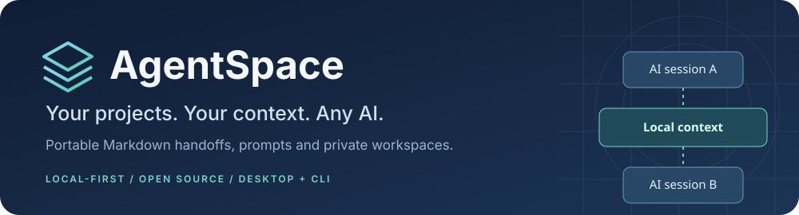
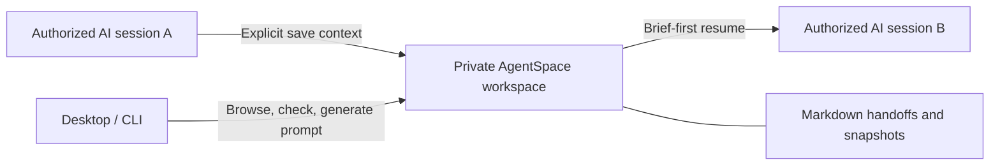

# AgentSpace



**Switch AI. Keep your progress.**

AgentSpace is a local-first workspace that helps you save project context and pick up where you left off in another AI session.

[](LICENSE)
[](https://www.python.org/)
[](https://github.com/guwoh/agentspace/actions/workflows/verify.yml)

[Tiếng Việt](README.vi.md) · [Desktop guide](docs/DESKTOP.md) · [DevSpace setup](docs/DEVSPACE.md) · [Changelog](CHANGELOG.md)

> **Development branch:** v0.3.0-dev adds an interactive fictional demo. The first published source preview is [v0.2.0](https://github.com/guwoh/agentspace/releases/tag/v0.2.0). Native builds, multi-monitor DPI and real cross-client handoff still require acceptance testing.

## Why AgentSpace?

An AI conversation can end, change models, or move to another authorized account. Your project should not lose its decisions, evidence, tasks and next steps.

AgentSpace keeps that working context in a private Markdown workspace under your control. The desktop app generates prompts and helps navigate the records; an authorized AI with file tools reads and updates them. You decide when to save.

### A concrete example

You are building a robot with ChatGPT. At the end of the session, explicitly ask the AI to save the design decisions, tested results and remaining tasks into AgentSpace. Later, open Claude or another AI with authorized file access, select the robot project in AgentSpace and copy a resume prompt. The new AI can read that saved handoff instead of asking you to reconstruct the entire project. Unsaved chat history is not transferred.

## Try it in one minute

```bash
git clone https://github.com/guwoh/agentspace.git
cd agentspace
python3 -B scripts/desktop.py
```

Click **Try demo**, then **Start project**. Explore the fictional robot's brief, session history and generated prompt. No account, AI connection or private workspace is needed for this local preview; it uses a temporary workspace that is removed when the app closes normally. Click **Exit demo** to return.

## Quick start

Requirements: Git and Python 3.8+; Tkinter for the desktop interface. On Ubuntu, install your distribution's Tkinter package if it is missing.

```bash
git clone https://github.com/guwoh/agentspace.git
cd agentspace
python3 scripts/agentspace.py init ~/work/agentspace-private
python3 -B scripts/desktop.py --workspace ~/work/agentspace-private
```

On Windows, use `python` instead of `python3` and choose a separate private folder such as `../agentspace-private`. The initializer only creates missing starter files.

In the desktop app, select a project (or generate a new-project prompt), select **Resume**, and use **Generate & copy**. Paste the prompt into your AI after connecting an authorized file-access tool. [DevSpace](docs/DEVSPACE.md) is one option. When you want a handoff, use the **Save context** prompt or explicitly ask the AI to save context.

No AI API key is needed by AgentSpace itself. Clipboard prompts are not sent automatically.

## Features

| Module | What it does |
| --- | --- |
| Projects | Search and browse the private registry, then copy a resume prompt in one click |
| Feature Map | Search feature IDs and keywords, follow dependency routes, validate paths and copy a focused read-only prompt |
| Prompt Studio | Generate resume, save, overview, handover, skill-update and new-project prompts |
| Context & History | Read brief, full handoff and saved snapshots |
| Skills | Create and edit private Markdown skill definitions |
| Connections | Open AI clients, launch the optional DevSpace configuration GUI, and check the local executable |
| Backup & Settings | Back up and restore private text records; adjust text size using buttons or keyboard shortcuts |
| CLI | Initialize, list, check and generate startup prompts without the GUI |

## Remote work with DevSpace

The optional companion GUI helps configure an independently installed DevSpace MCP server, manage allowed roots, check endpoints and connect supported AI clients. On a supported phone client, you can then work with your reachable laptop through the authorized AI. See the step-by-step [English guide](docs/DEVSPACE.md) or [Vietnamese guide](docs/DEVSPACE.vi.md). No credentials or server installation are bundled.

## How it works



1. **Work** — select one project; read its brief and the relevant evidence.
2. **Save** — explicitly request a full handoff, snapshot and brief.
3. **Resume** — reconnect file access in another session, select the same project and continue.

The desktop app is a local helper, not an autonomous AI agent. It does not authenticate MCP connections, export chat history or restore unsaved messages. Keep concurrent writers away from the same handoff.

## Private workspace layout

```text
agentspace-private/
├── AGENTS.md
├── protocol/
├── prompts/
├── skills/                     # Optional private skills
└── contexts/
    ├── INDEX.md
    └── demo-site/              # Fictional example project
        ├── BRIEF.md
        ├── FEATURE_MAP.md         # Optional task routing index
        ├── CURRENT.md
        └── sessions/
            └── YYYY-MM-DD-NN.md
```

The brief is the first entry point; CURRENT keeps the full handoff, and sessions retain immutable historical copies. The registry records the latest session. Each saved project should keep verified results distinct from plans. See the [workflow](protocol/WORKFLOW.md), [full handoff template](protocol/HANDOFF_TEMPLATE.md), [brief template](protocol/BRIEF_TEMPLATE.md) and [fictional example](examples/BRIEF.md).

### CLI usage

```bash
python3 scripts/agentspace.py status ~/work/agentspace-private
python3 scripts/agentspace.py start ~/work/agentspace-private demo-site
python3 scripts/agentspace.py check ~/work/agentspace-private demo-site
```

Replace the fictional ID with your own registered project. The checker compares the registry, session ID, full snapshot and brief metadata; it does not verify factual accuracy. Existing private folders can keep their registry and history; merge updated templates rather than overwriting files.

## Focused context routing

For long-running projects, maintain a small `FEATURE_MAP.md` next to the brief using the [feature map template](protocol/FEATURE_MAP_TEMPLATE.md). It records feature IDs, keywords, scoped source paths, dependencies and status. Check the source session against INDEX, then inspect only the relevant evidence. The map does not replace the full handoff.

Use the Feature map tab or the CLI (the map must already exist):

```bash
python3 scripts/agentspace.py map ~/work/agentspace-private demo-site "backup"
python3 scripts/agentspace.py map ~/work/agentspace-private demo-site --feature setup
python3 scripts/agentspace.py map-check ~/work/agentspace-private demo-site
```

Use your registered project ID and actual feature IDs. Path checks do not verify symbols, implementation or factual correctness. Token savings depend on the task and have not been benchmarked.

## Privacy and trust

- Keep real contexts, credentials, local paths, recordings and attachments outside the public checkout.
- AI file access still requires authorization. A cloud AI may receive the context you give it.
- Backup ZIPs contain private text and are not encrypted. Keep them private.
- Public content is audited with an explicit allowlist and secret/path checks; this is not a guarantee that all sensitive information is detected.

Read the [privacy guide](docs/PRIVACY.md) before publishing a fork or package.

## Development

```bash
python3 -B scripts/test_agentspace.py -v
python3 -B scripts/test_desktop.py -v
python3 -B scripts/check_public.py --history
```

The desktop build uses Tkinter. The initial preview passed 22 automated core tests and basic GUI and clipboard checks on Ubuntu. A GUI smoke test requires a graphical display or Xvfb. These tests do not certify live AI connections, multi-monitor DPI or cross-account handoffs. See [testing](docs/TESTING.md) and [desktop limitations](docs/DESKTOP.md).

The [package workflow](.github/workflows/package.yml) defines source and desktop build jobs. No stable installer or release is claimed.

## Contributing and license

Issues and focused pull requests are welcome. Describe reproducible steps, expected and actual behavior, platform and Python version. Use fictional or sanitized examples, never live personal context. Run the checks above and review staged files before opening a PR.

AgentSpace is licensed under the [MIT License](LICENSE). Inspired by [AGENTS.md](https://github.com/agentsmd/agents.md), [Cline Memory Bank](https://docs.cline.bot/best-practices/memory-bank) and [Beads](https://github.com/gastownhall/beads). DevSpace is an independent upstream project; its server code is not bundled. AgentSpace includes its own optional companion GUI.
