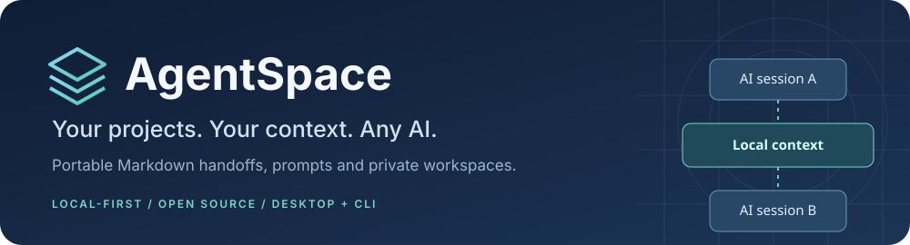
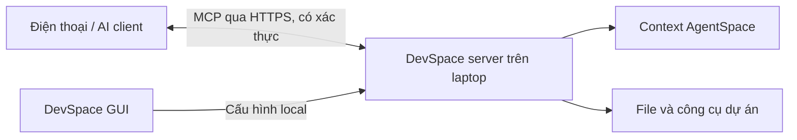

# AgentSpace



**Đổi AI, giữ nguyên tiến độ.**

AgentSpace là không gian làm việc AI mã nguồn mở giúp tích lũy bộ nhớ dự án, truy xuất đúng context cần thiết và chuyển đổi AI mà vẫn giữ được tiến độ đã lưu. Kết hợp **DevSpace GUI đi kèm** với DevSpace server cài riêng, bạn còn có thể làm việc với laptop từ điện thoại thông qua AI client được hỗ trợ.

[English](README.md) · [DevSpace GUI](#devspace-gui--làm-việc-từ-điện-thoại) · [Hướng dẫn DevSpace tiếng Việt](docs/DEVSPACE.vi.md) · [Desktop](docs/DESKTOP.md) · [Changelog](CHANGELOG.md)

> Nhánh phát triển v0.3.0-dev có DevSpace GUI, Feature Map, Quick Resume và demo tương tác. Bản public đầu tiên là [v0.2.0](https://github.com/guwoh/agentspace/releases/tag/v0.2.0). Chưa xác nhận bộ cài, DPI nhiều màn hình và chuyển giao giữa các client thực tế.

## Hai ứng dụng hỗ trợ một quy trình làm việc

| AgentSpace Desktop | DevSpace GUI |
| --- | --- |
| Quản lý bộ nhớ dự án, skill và Feature Map | Cấu hình DevSpace MCP server cài riêng |
| Tạo prompt tiếp quản và bàn giao | Quản lý thư mục cấp quyền và endpoint HTTPS |
| Tiếp tục công việc từ context đã lưu | Hỗ trợ kết nối ChatGPT / Claude với laptop |

## DevSpace GUI — làm việc từ điện thoại

Bạn có thể yêu cầu AI kiểm tra code, đọc tài liệu hoặc chạy kiểm thử trên laptop khi không ngồi trước máy, nếu kết nối và quyền được thiết lập phù hợp.



**DevSpace GUI đã được tích hợp trong repo.** Mở AgentSpace Desktop → **Connect → Open DevSpace GUI**, hoặc chạy trực tiếp:

```bash
python3 -B scripts/devspace_gui.py
```

GUI hỗ trợ nhập URL HTTPS, thêm/bỏ thư mục được cấp quyền, kiểm tra endpoint, sao chép URL MCP, mở thiết lập ChatGPT/Claude và sao chép Owner password có xác nhận. Trên Linux có thể khởi động lại user service systemd đã được thiết lập.

[**Hướng dẫn cài đặt và kết nối DevSpace bằng tiếng Việt**](docs/DEVSPACE.vi.md) · [English guide](docs/DEVSPACE.md) · [Mã nguồn GUI](scripts/devspace_gui.py)

DevSpace server là [dự án độc lập](https://github.com/Waishnav/devspace), phải cài riêng. Laptop, server và tunnel cần hoạt động; tài khoản/client AI phải hỗ trợ connector và được cấp quyền. Kết nối đầu cuối trên điện thoại chưa được kiểm thử đầy đủ.

## AgentSpace giải quyết vấn đề gì?

Khi đổi chat, model hoặc tài khoản AI được cấp quyền, bạn không muốn giải thích lại toàn bộ dự án. AgentSpace lưu quyết định, kết quả, nhiệm vụ, bằng chứng và hướng làm tiếp trong các file Markdown riêng trên máy.

Ứng dụng desktop giúp chọn dự án, xem lịch sử và tạo prompt; AI có công cụ đọc/ghi file được cấp quyền mới thực hiện việc tiếp quản và lưu context. Bạn quyết định thời điểm lưu.

## Ví dụ thực tế

Bạn đang thiết kế robot với ChatGPT. Khi kết thúc phiên, yêu cầu AI lưu quyết định thiết kế, kết quả đã kiểm tra và việc còn dở vào AgentSpace. Khi chuyển sang Claude hoặc một AI khác có quyền đọc file, chọn dự án robot và sao chép prompt tiếp quản. AI mới đọc hồ sơ đã lưu thay vì yêu cầu bạn kể lại mọi việc. Tin nhắn chưa lưu không được chuyển tự động.

## Trải nghiệm nhanh

Cần Git, Python 3.8+ và Tkinter.

```bash
git clone https://github.com/guwoh/agentspace.git
cd agentspace
python3 -B scripts/desktop.py
```

Ấn **Try demo**, rồi **Start project** để xem dự án robot giả lập, context, lịch sử và prompt. Không cần tài khoản AI hay kết nối DevSpace để thử giao diện. Demo nằm trong thư mục tạm, được dọn khi đóng app bình thường. Ấn **Exit demo** để quay lại.

## Bắt đầu với dự án thật

Cần Git, Python 3.8+ và Tkinter nếu sử dụng giao diện desktop.

```bash
git clone https://github.com/guwoh/agentspace.git
cd agentspace
python3 scripts/agentspace.py init ~/work/agentspace-private
python3 -B scripts/desktop.py --workspace ~/work/agentspace-private
```

Trên Windows dùng `python` và chọn thư mục riêng, ví dụ `../agentspace-private`. Lệnh init không ghi đè file đã có.

Chọn dự án (hoặc tạo prompt cho dự án mới), chọn Resume, ấn Generate & copy rồi dán vào AI đã kết nối công cụ file, chẳng hạn [DevSpace](docs/DEVSPACE.md). Khi cần bàn giao, chọn Save context hoặc yêu cầu AI lưu context rõ ràng.

## Chức năng

| Module | Công dụng |
| --- | --- |
| Projects | Tìm kiếm, chọn dự án và sao chép prompt tiếp quản một lần bấm |
| Feature Map | Tra chức năng, đường dẫn nguồn, phụ thuộc và sinh prompt tập trung |
| Prompt Studio | Tiếp quản, lưu, tổng quan, bàn giao, cập nhật skill và dự án mới |
| Context & History | Đọc brief, context đầy đủ và snapshot |
| Skills | Tạo, sửa skill Markdown riêng |
| Connections | Mở AI client, DevSpace GUI và kiểm tra executable DevSpace |
| Backup & Settings | Sao lưu/phục hồi hồ sơ văn bản, chỉnh cỡ chữ bằng nút hoặc phím tắt |
| CLI | Khởi tạo, liệt kê, kiểm tra, sinh prompt |

## Cơ chế lưu và tiếp quản

AI đọc BRIEF trước, mở CURRENT và bằng chứng liên quan khi thiếu thông tin. Khi lưu theo yêu cầu rõ ràng, AI tạo snapshot đầy đủ, cập nhật CURRENT, sinh BRIEF và đồng bộ INDEX. Không khôi phục được tin nhắn chưa từng lưu. Không để nhiều AI đồng thời ghi cùng hồ sơ.

Xem [quy trình](protocol/WORKFLOW.md), [mẫu đầy đủ](protocol/HANDOFF_TEMPLATE.md), [mẫu brief](protocol/BRIEF_TEMPLATE.md) và [ví dụ hư cấu](examples/BRIEF.md).

## Định tuyến context theo chức năng

`FEATURE_MAP.md` là mục lục nhỏ đặt cạnh BRIEF, lưu ID chức năng, từ khóa, nguồn, phụ thuộc và trạng thái. AI đối chiếu phiên nguồn với INDEX, đọc đúng nguồn cần thiết; chỉ mở CURRENT/lịch sử khi thiếu hoặc cần đối chiếu. Tab Feature map hỗ trợ tìm kiếm, kiểm tra và sao chép prompt chỉ đọc. Xem [mẫu](protocol/FEATURE_MAP_TEMPLATE.md) và [hướng dẫn CLI](README.md#focused-context-routing). Chưa đo mức tiết kiệm token thực tế; kiểm tra đường dẫn không đồng nghĩa kiểm chứng nội dung.

## Dữ liệu và giới hạn

AgentSpace không tự gửi prompt, không kết nối MCP thay người dùng và không cần AI API key. AI đám mây có thể nhận dữ liệu bạn cấp quyền đọc. Giữ context thật, đường dẫn nội bộ, token, transcript và ảnh riêng ngoài checkout công khai. Gói backup không mã hóa. Xem [quy định riêng tư](docs/PRIVACY.md).

Xem [hướng dẫn desktop](docs/DESKTOP.md), [kiểm thử](docs/TESTING.md) và [hướng dẫn CLI](README.md#cli-usage). Native build, DPI nhiều màn hình và handoff giữa tài khoản vẫn cần kiểm thử thực tế.

## Đóng góp

Hoan nghênh issue và PR có bước tái hiện rõ ràng, dùng dữ liệu giả hoặc đã loại bỏ thông tin riêng. Kiểm tra danh sách file và chạy test trước khi gửi.

Giấy phép [MIT](LICENSE).
